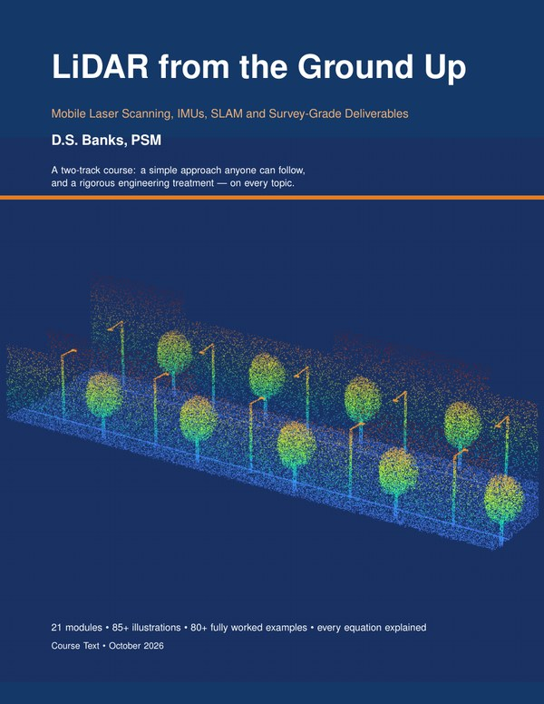
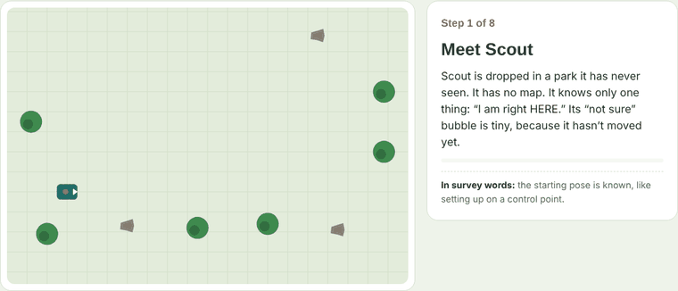

# LiDAR from the Ground Up
**Mobile Laser Scanning, IMUs, SLAM and Survey-Grade Deliverables** · D.S. Banks, PSM

*Look for this cover to be sure you have the official course materials.*

Source files for a continuing-education (CE) course for surveyors, engineers and geospatial professionals. The course covers mobile LiDAR from first principles ("light bounces back") through the factor-graph mathematics inside modern SLAM software such as LIO-SAM, and on to the accuracy statistics a surveyor signs off on.

It is a two-track course. Every module has a plain-language explanation anyone can follow, alongside a rigorous engineering treatment of the same topic.

The course was built from an earlier *Mobile LiDAR Basics* seminar, a four-module course outline, and the LIO-SAM research paper (Shan *et al.*, 2020). Those sources were reorganized, corrected and greatly expanded.

## Read the course

The course is taught as three seminars, backed by the Reference Book.

### Seminar 1: Surveying Concepts (R1)

| Document | Description | |
|----------|-------------|---|
| 🎓 [**Seminar edition** (PDF, 71 pages)](docs/LiDAR_from_the_Ground_Up_R1.pdf) | The Surveying Concepts edition used in the seminar: all 21 modules in plain language, with every Simple Approach, Big Idea, Field Tip and Warning box and the illustrations | [⬇ Download](https://github.com/band72/Seminar-Mobile-LiDAR-from-the-Ground-Up/raw/main/docs/LiDAR_from_the_Ground_Up_R1.pdf) |
| 🎤 [**Seminar slides with speaker notes** (PDF, 76 pages)](docs/Seminar_Slides_with_Notes_R0.pdf) | The six-hour seminar presentation, with the presenter's notes for each slide | [⬇ Download](https://github.com/band72/Seminar-Mobile-LiDAR-from-the-Ground-Up/raw/main/docs/Seminar_Slides_with_Notes_R0.pdf) |

### Seminar 2: Engineering, Error Budgets and Standards in Numbers

The advanced seminar. It covers what Seminar 1 leaves out: the engineering track of the Reference Book, with calculations on every topic.

| Document | Description | |
|----------|-------------|---|
| 🎤 [**Seminar 2 slides with speaker notes** (PDF, 64 pages)](docs/Seminar_2_Slides_with_Notes.pdf) | The six-hour advanced presentation, with the presenter's notes for each slide | [⬇ Download](https://github.com/band72/Seminar-Mobile-LiDAR-from-the-Ground-Up/raw/main/docs/Seminar_2_Slides_with_Notes.pdf) |
| 🖥️ [**Seminar 2 slides** (PDF, 64 slides)](docs/Seminar_2_Slides.pdf) | The same slides full screen, for presenting | [⬇ Download](https://github.com/band72/Seminar-Mobile-LiDAR-from-the-Ground-Up/raw/main/docs/Seminar_2_Slides.pdf) |
| 📐 [**Seminar 2 design**](docs/seminars/Seminar_2_Advanced_Design.md) | Six-hour agenda in six sessions: the single measurement in numbers; pose, IMU and calibration math; estimation (Kalman filter, ICP, factor graphs); error propagation and budgets; hardware in numbers; the ASPRS and FDOT standards in numbers. With learning objectives, in-seminar labs, materials and the assessment plan | [Open](docs/seminars/Seminar_2_Advanced_Design.md) |

Seminar 2 uses the Reference Book, the worked-examples workbook and the Supplementary Information. Its 20-problem set and answer key are held with the instructor materials.

### Seminar 3: Mobile LiDAR Projects (in development)

Projects only, with no lectures. Five projects worked from scope to signed deliverable under the ASPRS and FDOT standards.

| Document | Description |
|----------|-------------|
| 🛠️ [**Seminar 3 design**](docs/seminars/Seminar_3_Projects_Design.md) | 1. Urban arterial resurfacing design (FDOT Type A) · 2. Rural highway asset inventory and earthwork (Type B) · 3. Interchange with GNSS outages (Type A through an underpass) · 4. County road elevations for flood vulnerability (Type C) · 5. Independent acceptance test of a delivered dataset |

**Seminar 3 is not complete.** It cannot be offered until each project has real, de-identified project data. The design lists the data each project needs.

### Reference Book (R0.1)

| Document | Description | |
|----------|-------------|---|
| 📘 [**Reference Book**, R0.1 (PDF, 190 pages)](docs/LiDAR_from_the_Ground_Up_R0.pdf) | The full book: 21 modules with the engineering track, worked examples, labs, sample SOP, glossary and references | [⬇ Download](https://github.com/band72/Seminar-Mobile-LiDAR-from-the-Ground-Up/raw/main/docs/LiDAR_from_the_Ground_Up_R0.pdf) |
| 🛠️ [**Projects** (PDF, 11 pages)](docs/LiDAR_Projects_R0.pdf) | The capstone project (Module 21) with the sample project dataset and filled-in accuracy report, and the five hands-on labs (Appendix D), taken unchanged from the Reference Book | [⬇ Download](https://github.com/band72/Seminar-Mobile-LiDAR-from-the-Ground-Up/raw/main/docs/LiDAR_Projects_R0.pdf) |

All PDFs are compressed for download. The Reference Book, module PDFs and Projects are revision **R0.1** (November 2026: Module 1 expanded with system anatomy, error growth, point density, precision vs. accuracy and ASPRS Edition 2, plus exercises 1.3–1.6); the original R0 text is kept under the [`R0` tag](https://github.com/band72/Seminar-Mobile-LiDAR-from-the-Ground-Up/tree/R0). The Seminar edition is R1.

## Download the exercise files

| File | Description | |
|------|-------------|---|
| 📊 [**Worked-examples workbook**](docs/LiDAR_Worked_Examples.xlsx) (Excel, 23 sheets) | Every worked example from the book, rebuilt with live formulas, one sheet per module, plus a Monte Carlo sheet and the capstone dataset | [⬇ Download](https://github.com/band72/Seminar-Mobile-LiDAR-from-the-Ground-Up/raw/main/docs/LiDAR_Worked_Examples.xlsx) |
| 📍 [**Sample checkpoints**](figs/sample_checkpoints.csv) (CSV, 30 points) | Checkpoint survey vs. LiDAR elevations with dE, dN and dZ, for the capstone accuracy test | [⬇ Download](https://github.com/band72/Seminar-Mobile-LiDAR-from-the-Ground-Up/raw/main/figs/sample_checkpoints.csv) |
| 🚗 [**Sample trajectory**](figs/sample_trajectory.csv) (CSV, 2 km) | Vehicle trajectory with position, heading, standard deviations and GNSS status, including a GNSS outage | [⬇ Download](https://github.com/band72/Seminar-Mobile-LiDAR-from-the-Ground-Up/raw/main/figs/sample_trajectory.csv) |

## Modules

| # | Module | Source | PDF | Notes |
|---|--------|--------|-----|-------|
| 1 | [What Is LiDAR?](tex/ch01_intro.tex) | [`ch01_intro.tex`](tex/ch01_intro.tex) | [📄 PDF](docs/modules/Module_01_R0.pdf) | [🧩 Simple Concept](docs/notes/Simple_Concept_01.pdf) |
| 2 | [The Math Toolkit](tex/ch02_math.tex) | [`ch02_math.tex`](tex/ch02_math.tex) | [📄 PDF](docs/modules/Module_02_R0.pdf) | [🧩 Simple Concept](docs/notes/Simple_Concept_02.pdf) |
| 3 | [Measuring Distance with Light](tex/ch03_tof.tex) | [`ch03_tof.tex`](tex/ch03_tof.tex) | [📄 PDF](docs/modules/Module_03_R0.pdf) | [🧩 Simple Concept](docs/notes/Simple_Concept_03.pdf) |
| 4 | [The Laser Beam and the Echo](tex/ch04_beam.tex) | [`ch04_beam.tex`](tex/ch04_beam.tex) | [📄 PDF](docs/modules/Module_04_R0.pdf) | [🧩 Simple Concept](docs/notes/Simple_Concept_04.pdf) |
| 5 | [From Angles and Distance to X, Y, Z](tex/ch05_polar.tex) | [`ch05_polar.tex`](tex/ch05_polar.tex) | [📄 PDF](docs/modules/Module_05_R0.pdf) | [🧩 Simple Concept](docs/notes/Simple_Concept_05.pdf) |
| 6 | [Rotation, Pose and Frames](tex/ch06_rotation.tex) | [`ch06_rotation.tex`](tex/ch06_rotation.tex) | [📄 PDF](docs/modules/Module_06_R0.pdf) | [🧩 Simple Concept](docs/notes/Simple_Concept_06.pdf) |
| 7 | [The IMU: Feeling Motion](tex/ch07_imu.tex) | [`ch07_imu.tex`](tex/ch07_imu.tex) | [📄 PDF](docs/modules/Module_07_R0.pdf) | [🧩 Simple Concept](docs/notes/Simple_Concept_07.pdf) |
| 8 | [Timing, GNSS and Motion Compensation](tex/ch08_timing.tex) | [`ch08_timing.tex`](tex/ch08_timing.tex) | [📄 PDF](docs/modules/Module_08_R0.pdf) | [🧩 Simple Concept](docs/notes/Simple_Concept_08.pdf) |
| 9 | [Lever Arm and Boresight Calibration](tex/ch09_calib.tex) | [`ch09_calib.tex`](tex/ch09_calib.tex) | [📄 PDF](docs/modules/Module_09_R0.pdf) | [🧩 Simple Concept](docs/notes/Simple_Concept_09.pdf) |
| 10 | [SLAM: Mapping While Finding Yourself](tex/ch10_slam.tex) | [`ch10_slam.tex`](tex/ch10_slam.tex) | [📄 PDF](docs/modules/Module_10_R0.pdf) | [🧩 Simple Concept](docs/notes/Simple_Concept_10.pdf) |
| 11 | [Scan Matching: Fitting Clouds Together](tex/ch11_scanmatch.tex) | [`ch11_scanmatch.tex`](tex/ch11_scanmatch.tex) | [📄 PDF](docs/modules/Module_11_R0.pdf) | [🧩 Simple Concept](docs/notes/Simple_Concept_11.pdf) |
| 12 | [Factor Graphs and LIO-SAM](tex/ch12_factor.tex) | [`ch12_factor.tex`](tex/ch12_factor.tex) | [📄 PDF](docs/modules/Module_12_R0.pdf) | [🧩 Simple Concept](docs/notes/Simple_Concept_12.pdf) |
| 13 | [Control, Error Budgets and Accuracy Standards (incl. ASPRS Edition 2)](tex/ch13_accuracy.tex) | [`ch13_accuracy.tex`](tex/ch13_accuracy.tex) | [📄 PDF](docs/modules/Module_13_R0.pdf) | [🧩 Simple Concept](docs/notes/Simple_Concept_13.pdf) |
| 14 | [Error Propagation and Error Budgets](tex/ch13b_errprop.tex) | [`ch13b_errprop.tex`](tex/ch13b_errprop.tex) | [📄 PDF](docs/modules/Module_14_R0.pdf) | [🧩 Simple Concept](docs/notes/Simple_Concept_14.pdf) |
| 15 | [Ouster OS0 Case Study: Errors and Resolution](tex/ch13c_os0.tex) | [`ch13c_os0.tex`](tex/ch13c_os0.tex) | [📄 PDF](docs/modules/Module_15_R0.pdf) | [🧩 Simple Concept](docs/notes/Simple_Concept_15.pdf) |
| 16 | [Choosing an IMU: AHRS, GNSS/INS and Tactical GNSS/INS](tex/ch13d_gx5.tex) | [`ch13d_gx5.tex`](tex/ch13d_gx5.tex) | [📄 PDF](docs/modules/Module_16_R0.pdf) | [🧩 Simple Concept](docs/notes/Simple_Concept_16.pdf) |
| 17 | [Survey-Grade Case Study: RIEGL VUX-240](tex/ch13e_riegl.tex) | [`ch13e_riegl.tex`](tex/ch13e_riegl.tex) | [📄 PDF](docs/modules/Module_17_R0.pdf) | [🧩 Simple Concept](docs/notes/Simple_Concept_17.pdf) |
| 18 | [Processing, QA/QC and Deliverables](tex/ch14_processing.tex) | [`ch14_processing.tex`](tex/ch14_processing.tex) | [📄 PDF](docs/modules/Module_18_R0.pdf) | [🧩 Simple Concept](docs/notes/Simple_Concept_18.pdf) |
| 19 | [Florida Standards of Practice, FDOT and the New Datums](tex/ch14b_florida.tex) | [`ch14b_florida.tex`](tex/ch14b_florida.tex) | [📄 PDF](docs/modules/Module_19_R0.pdf) | [🧩 Simple Concept](docs/notes/Simple_Concept_19.pdf) |
| 20 | [Professional Practice for LiDAR Surveys](tex/ch14c_practice.tex) | [`ch14c_practice.tex`](tex/ch14c_practice.tex) | [📄 PDF](docs/modules/Module_20_R0.pdf) | [🧩 Simple Concept](docs/notes/Simple_Concept_20.pdf) |
| 21 | [Capstone and Sample Project Dataset](tex/ch15_capstone.tex) | [`ch15_capstone.tex`](tex/ch15_capstone.tex) | [📄 PDF](docs/modules/Module_21_R0.pdf) | [🧩 Simple Concept](docs/notes/Simple_Concept_21.pdf) |

Back matter ([`ch16_back.tex`](tex/ch16_back.tex)) includes answers to the in-text exercises, [hands-on labs](tex/ch16b_labs.tex), a [sample SOP and client accuracy agreement](tex/ch16c_sop.tex), an equation summary, a glossary and references. The front matter and "How to Use This Course" are in [`ch00_front.tex`](tex/ch00_front.tex).

## Repository layout

<details>
<summary>Show the folders and files in this repository</summary>

| Path | Contents |
|------|----------|
| [`docs/`](docs/) | Seminar edition, Reference Book, Projects and seminar slides (PDF), the worked-examples workbook, and the [Supplementary Information](#supplementary-information) documents in [`docs/supplementary/`](docs/supplementary/) (see [Read the course](#read-the-course) and [Download the exercise files](#download-the-exercise-files)) |
| [`tex/`](tex/) | LaTeX sources of the Reference Book: the master document, chapters, inserts, quiz questions and sample table |
| [`tex/main.tex`](tex/main.tex) | Master document. Build this to produce the Reference Book (R0.1). |
| [`r1/`](r1/) | Builds the Seminar edition (R1) from the R0 chapters, which it only reads ([`r1/build_r1.py`](r1/build_r1.py), checked by [`r1/check_boxes.py`](r1/check_boxes.py)) |
| [`modules/`](modules/) | Builds one PDF per module from the R0 chapters ([`modules/build_modules.py`](modules/build_modules.py)); the PDFs are in [`docs/modules/`](docs/modules/) |
| [`notes/`](notes/) | Builds the one-page Simple Concept notes, one per module ([`notes/build_notes.py`](notes/build_notes.py), text and drawings in [`notes/content.py`](notes/content.py)); the PDFs are in [`docs/notes/`](docs/notes/) |
| [`slides/`](slides/) | Builds the Seminar 2 slide deck and its speaker-notes pages ([`slides/build_slides.py`](slides/build_slides.py), content in [`slides/seminar2.py`](slides/seminar2.py)) |
| [`projects/`](projects/) | Builds the Projects download from the R0 capstone and labs chapters ([`projects/build_projects.py`](projects/build_projects.py)) |
| `tex/ch*.tex` | Module chapters (linked in the table above) |
| [`tex/ins_asprs.tex`](tex/ins_asprs.tex), [`ins_pen.tex`](tex/ins_pen.tex), [`ins_rhr.tex`](tex/ins_rhr.tex), [`ins_traj.tex`](tex/ins_traj.tex) | Inserts used within the chapters |
| [`tex/quiz_items.tex`](tex/quiz_items.tex), [`tex/sample_table.tex`](tex/sample_table.tex) | Quiz questions (no answers) and the sample results table |
| [`figs/`](figs/) | Figures |
| [`figs/sample_trajectory.csv`](figs/sample_trajectory.csv), [`figs/sample_checkpoints.csv`](figs/sample_checkpoints.csv), [`figs/sample_stats.json`](figs/sample_stats.json) | Sample project dataset used in the capstone |
| [`scripts/`](scripts/) | Python scripts. Run them from the repository root, for example `python3 scripts/figs1.py`. |
| [`scripts/style.py`](scripts/style.py), `scripts/figs1.py` … `scripts/figs9.py`, [`scripts/crop.py`](scripts/crop.py) | Scripts that generate the figures |
| [`scripts/calc.py`](scripts/calc.py), [`calc2.py`](scripts/calc2.py), [`calc3.py`](scripts/calc3.py), [`calc_ep.py`](scripts/calc_ep.py), [`calc_ep2.py`](scripts/calc_ep2.py), [`calc_riegl.py`](scripts/calc_riegl.py), [`calc_trav.py`](scripts/calc_trav.py) | Scripts behind the worked examples' numbers |
| [`scripts/usfix.py`](scripts/usfix.py) | Converts British spellings to US spellings in the chapter files |
| [`xl/`](xl/) | Builds the companion Excel workbook of worked examples ([`xl/build.py`](xl/build.py)) |
| [`review/`](review/) | [`tech_review.py`](review/tech_review.py) recomputes key printed values; results in [`Technical_Review_Log.txt`](review/Technical_Review_Log.txt) |
| [`LICENSE`](LICENSE), [`LICENSE-CODE`](LICENSE-CODE) | Content license (CC BY-NC-ND 4.0) and code license (MIT) |

</details>

## Building

<details>
<summary>Show how to build the PDFs, figures, workbook and technical review</summary>

Requires a LaTeX distribution such as TeX Live, with TikZ. The edition scripts also need Python 3 and Ghostscript (`gs`) for compression.

**Reference Book (R0.1)**:

```bash
cd tex && latexmk -pdf main.tex
```

**Seminar edition (R1)**: generates the R1 chapters, checks every kept box and figure against R0, compiles, and writes the compressed `docs/LiDAR_from_the_Ground_Up_R1.pdf`.

```bash
r1/make_pdf.sh
```

**Module PDFs**: builds the full Reference Book once to resolve cross-references, then writes one compressed PDF per module to `docs/modules/`.

```bash
python3 modules/build_modules.py
```

**Simple Concept notes**: writes one single-page PDF per module to `docs/notes/`.

```bash
python3 notes/build_notes.py
```

**Seminar 2 slides**: writes `docs/Seminar_2_Slides.pdf` and `docs/Seminar_2_Slides_with_Notes.pdf`.

```bash
python3 slides/build_slides.py seminar2 Seminar_2_Slides
```

**Projects**: writes the compressed `docs/LiDAR_Projects_R0.pdf`.

```bash
projects/make_pdf.sh
```

**Figures**: requires Python 3 with `matplotlib`, `numpy` and `Pillow`.

```bash
python3 scripts/figs1.py
```

(Repeat for `scripts/figs2.py` … `scripts/figs9.py`. Run `scripts/calc_ep2.py` before `scripts/figs4.py`, which reads its Monte Carlo output.)

**Worked-examples workbook**: a ready-made copy is in [`docs/`](docs/LiDAR_Worked_Examples.xlsx). To rebuild it, install `openpyxl`; the script writes `xl/LiDAR_Worked_Examples.xlsx`.

```bash
cd xl && python3 build.py
```

**Technical review**: recomputes key printed values and reports PASS/CHECK.

```bash
python3 review/tech_review.py
```

</details>

## Assessment materials

The quiz answer key, the final-exam builder, and the Seminar 2 problem set with its answer key are not published here. Instructors can request them from the author.

## Updates

This course is maintained as a living document and will be refined at regular intervals as standards and technology change. A project-based companion with worked, real-world examples is in development to clarify and standardize LiDAR deliverables.

Each revision is published as a [GitHub Release](https://github.com/band72/Seminar-Mobile-LiDAR-from-the-Ground-Up/releases) with a summary of what changed. Questions, corrections and project ideas for the companion are welcome in [Discussions](https://github.com/band72/Seminar-Mobile-LiDAR-from-the-Ground-Up/discussions).

## Supplementary Information

Reference documents for planning, scoping and testing mobile LiDAR surveys in Florida.

### Florida agency standards and guidelines

**FDOT Terrestrial Mobile LiDAR survey types** (FDOT Surveying and Mapping Handbook, February 28, 2025, Section 39.6.2)

| Type | Accuracy (95% confidence) | Control and checkpoint layout (recommended) | GNSS outages (course recommendation) |
|------|---------------------------|---------------------------------------------|--------------------------------------|
| A | H and V ≤ 0.06 ft; ≥ 20 points/ft² | control pairs ≤ 1000 ft apart, on each side of the road; checkpoints ≤ 1000 ft apart | fixed solution wherever the sky allows; predicted drift through any outage within tolerance; a control target and a checkpoint inside every outage |
| B | H and V ≤ 0.10 ft; ≥ 10 points/ft² | control pairs ≤ 1500 ft apart, on each side of the road; checkpoints 1000–2500 ft apart | fixed solution wherever the sky allows; predicted drift through any outage within tolerance; a control target and a checkpoint inside every outage |
| C | set by the PSM in responsible charge and the scope of services | chosen by the PSM; published control may be used with Department approval | per scope |

Spacing values are recommendations; the PSM in responsible charge sets the final layout. Confirm the Handbook edition named in your contract.

The GNSS column is this course's recommendation, not an FDOT requirement. The Handbook (Section 39.6.2, Note 4) says only that stretches with fewer than 5 satellites in view must not exceed what the IMU can bridge. A blanket 100% fixed target is not achievable on most corridors, so outages are managed instead: report the percentage of the trajectory with a fixed solution, the length of every outage and how each was bridged.

▶ **[Recommendations](docs/supplementary/13_FDOT_Mobile_Lidar_Standards_Recommendations.md)**: nine problems with these standards and how to work around them, with control spacing, IMU drift and vibration, and what limits SLAM accuracy.

| Document | Description | |
|----------|-------------|---|
| 📘 [**FDOT Surveying and Mapping Handbook**](docs/supplementary/01_FDOT_Surveying_and_Mapping_Handbook_2025-02-28.pdf) (PDF, 146 pages) | Current edition (February 28, 2025). Sections 35–40 and Appendix C cover Terrestrial Mobile LiDAR (Module 19) | [⬇ Download](https://github.com/band72/Seminar-Mobile-LiDAR-from-the-Ground-Up/raw/main/docs/supplementary/01_FDOT_Surveying_and_Mapping_Handbook_2025-02-28.pdf) |
| 📝 [**Handbook summary of changes**](docs/supplementary/02_FDOT_Handbook_Summary_of_Changes_2025-02-28.pdf) (PDF, 16 pages) | What changed in the February 2025 Handbook | [⬇ Download](https://github.com/band72/Seminar-Mobile-LiDAR-from-the-Ground-Up/raw/main/docs/supplementary/02_FDOT_Handbook_Summary_of_Changes_2025-02-28.pdf) |
| 📄 [**FDOT Procedure 550-030-101, Surveying and Mapping**](docs/supplementary/03_FDOT_Surveying_and_Mapping_Procedure_550-030-101.pdf) (PDF, 6 pages) | The FDOT procedure that the Handbook supplements (effective May 14, 2019) | [⬇ Download](https://github.com/band72/Seminar-Mobile-LiDAR-from-the-Ground-Up/raw/main/docs/supplementary/03_FDOT_Surveying_and_Mapping_Procedure_550-030-101.pdf) |
| 📄 [**FDOT Terrestrial Mobile LiDAR general scope**](docs/supplementary/04_FDOT_Terrestrial_Mobile_Lidar_General_Scope_Guidelines_2014.pdf) (PDF, 2 pages) | Activity 30 scope language for Terrestrial Mobile LiDAR (2014) | [⬇ Download](https://github.com/band72/Seminar-Mobile-LiDAR-from-the-Ground-Up/raw/main/docs/supplementary/04_FDOT_Terrestrial_Mobile_Lidar_General_Scope_Guidelines_2014.pdf) |
| 📊 [**FDOT Terrestrial Mobile LiDAR staff-hour guidelines**](docs/supplementary/05_FDOT_Terrestrial_Mobile_Lidar_Staff_Hour_Guidelines_2015.xlsx) (Excel) | Task-by-task staff-hour estimating guide for Activity 30 (2015) | [⬇ Download](https://github.com/band72/Seminar-Mobile-LiDAR-from-the-Ground-Up/raw/main/docs/supplementary/05_FDOT_Terrestrial_Mobile_Lidar_Staff_Hour_Guidelines_2015.xlsx) |
| 📄 [**FDOT Digital Corridor Strategic Framework Plan**](docs/supplementary/06_FDOT_Digital_Corridor_Strategic_Framework_Plan_2023.pdf) (PDF, 59 pages) | Technology review prepared for the FDOT Surveying and Mapping Office (June 30, 2023) | [⬇ Download](https://github.com/band72/Seminar-Mobile-LiDAR-from-the-Ground-Up/raw/main/docs/supplementary/06_FDOT_Digital_Corridor_Strategic_Framework_Plan_2023.pdf) |
| 📄 [**Florida's Turnpike Enterprise scope of services**](docs/supplementary/07_FTE_Surveying_and_Mapping_Scope_of_Services_2022.pdf) (PDF, 65 pages) | Exhibit A for the surveying and mapping continuing services contract, including Activity 30 Terrestrial Mobile LiDAR (September 30, 2022) | [⬇ Download](https://github.com/band72/Seminar-Mobile-LiDAR-from-the-Ground-Up/raw/main/docs/supplementary/07_FTE_Surveying_and_Mapping_Scope_of_Services_2022.pdf) |
| 📄 [**Monroe County mobile LiDAR accuracy assessment**](docs/supplementary/08_Monroe_County_Mobile_Lidar_Accuracy_Assessment_2019.pdf) (PDF, 7 pages) | Technical memorandum on the vertical accuracy of mobile LiDAR road elevations and finished-floor elevations (2019) | [⬇ Download](https://github.com/band72/Seminar-Mobile-LiDAR-from-the-Ground-Up/raw/main/docs/supplementary/08_Monroe_County_Mobile_Lidar_Accuracy_Assessment_2019.pdf) |

Documents 01–08 are published by FDOT, Florida's Turnpike Enterprise and Monroe County. They are copied here for convenience, are not covered by this repository's license, and may have been superseded: always check the publisher for the current edition.

### Course companion documents

| Document | Description | |
|----------|-------------|---|
| 📄 [**Mobile LiDAR accuracy testing SOP**](docs/supplementary/09_Mobile_Lidar_Accuracy_Testing_SOP.pdf) (PDF, 8 pages) | Step-by-step independent checkpoint test: at least 30 checkpoints, RMSE computation and reporting | [⬇ PDF](https://github.com/band72/Seminar-Mobile-LiDAR-from-the-Ground-Up/raw/main/docs/supplementary/09_Mobile_Lidar_Accuracy_Testing_SOP.pdf) · [⬇ Word](https://github.com/band72/Seminar-Mobile-LiDAR-from-the-Ground-Up/raw/main/docs/supplementary/09_Mobile_Lidar_Accuracy_Testing_SOP.docx) |
| 📄 [**Florida mobile LiDAR projects, Nov 2023 – Nov 2026**](docs/supplementary/10_Florida_Mobile_Lidar_Projects_2023-2026.pdf) (PDF, 10 pages) | Survey of about 15 Florida mobile LiDAR efforts and what public accuracy documentation exists for each | [⬇ PDF](https://github.com/band72/Seminar-Mobile-LiDAR-from-the-Ground-Up/raw/main/docs/supplementary/10_Florida_Mobile_Lidar_Projects_2023-2026.pdf) · [⬇ Word](https://github.com/band72/Seminar-Mobile-LiDAR-from-the-Ground-Up/raw/main/docs/supplementary/10_Florida_Mobile_Lidar_Projects_2023-2026.docx) |
| 📄 [**How to read mobile laser scanner accuracy specifications**](docs/supplementary/11_How_to_Read_Mobile_Laser_Scanner_Accuracy_Specifications.pdf) (PDF, 12 pages) | What a scanner datasheet does and does not tell you about delivered accuracy | [⬇ PDF](https://github.com/band72/Seminar-Mobile-LiDAR-from-the-Ground-Up/raw/main/docs/supplementary/11_How_to_Read_Mobile_Laser_Scanner_Accuracy_Specifications.pdf) · [⬇ Word](https://github.com/band72/Seminar-Mobile-LiDAR-from-the-Ground-Up/raw/main/docs/supplementary/11_How_to_Read_Mobile_Laser_Scanner_Accuracy_Specifications.docx) |
| 📊 [**Mobile LiDAR accuracy workbook**](docs/supplementary/12_Mobile_Lidar_Accuracy_Workbook.xlsx) (Excel, 6 sheets) | FDOT limits converted to ASPRS RMSE, scanner comparisons, a checkpoint test, and three worked examples (raw vs. adjusted, control adjustment, GNSS outage) | [⬇ Download](https://github.com/band72/Seminar-Mobile-LiDAR-from-the-Ground-Up/raw/main/docs/supplementary/12_Mobile_Lidar_Accuracy_Workbook.xlsx) |
| 📄 [**FDOT mobile LiDAR standards: problems and recommendations**](docs/supplementary/13_FDOT_Mobile_Lidar_Standards_Recommendations.md) (web page) | Nine problems with the FDOT Type A, B and C standards, with a recommended practice for each: control spacing, IMU drift, vibration and mounting, and what limits SLAM accuracy | [Open](docs/supplementary/13_FDOT_Mobile_Lidar_Standards_Recommendations.md) |

> **Disclaimer about named companies.** Documents 10, 11 and 12 name firms, agencies, manufacturers and products. They are named only to identify projects or to illustrate how published specifications are read, using publicly available sources (agency records, company websites and datasheets) as of November 2026. In the Florida projects review, a verdict of U or X means only that no public accuracy documentation was found; it is not a finding that any project, firm or dataset failed a standard or was performed improperly, and accuracy documentation may exist that is not public. Details taken from marketing pages are unverified, and current manufacturer datasheets always govern. No endorsement or criticism of any company is intended. Product names are trademarks of their respective owners. Corrections are welcome in [Discussions](https://github.com/band72/Seminar-Mobile-LiDAR-from-the-Ground-Up/discussions).

## Tools

### LiDAR Contour Studio — open-source contour generator for LAS/LAZ
**Repository:** [github.com/band72/Lidar_Prj_2026](https://github.com/band72/Lidar_Prj_2026)

An open-source companion tool, released under the MIT License, for turning LAS/LAZ point clouds into contours and surfaces:

- Filters ground points by ASPRS class and removes statistical outliers
- Crops by a latitude/longitude bounding box drawn on a map, and by elevation
- Exports contours to GeoJSON, Shapefile, AutoCAD DXF and GeoPackage, and a DEM to GeoTIFF
- Writes QA/QC reports (HTML, Markdown, JSON) covering metadata, point density, datums and limitations
- Runs on Windows, Linux and Android, with a touch-friendly web interface

It applies the processing and QA/QC steps taught in Module 18 of the seminar.

### Scout Maps the Park: SLAM animation

[](https://band72.github.io/Seminar-Mobile-LiDAR-from-the-Ground-Up/slam-animation.html)

An interactive, eight-step animation of how SLAM works: look, roll and guess, match, fix, and close the loop. Each step includes a note in survey terms.

▶ **[Open the interactive animation](https://band72.github.io/Seminar-Mobile-LiDAR-from-the-Ground-Up/slam-animation.html)**

▶ **[SLAM Lectures for Beginner](https://www.youtube.com/watch?v=B2qzYCeT9oQ&list=PLpUPoM7Rgzi_7YWn14Va2FODh7LzADBSm)** 

▶ **[Learn LiDAR with Robotics](https://www.theconstruct.ai/)** (omitted from the seminar)

▶ **[Photogrammetry & Robotics Bonn](https://github.com/PRBonn)**

## To-do

- [ ] Independent review of the Florida standards module by a second PSM
- [ ] Expand the examples for post processing the bulk data with open source software and integrate with Civil 3D.
- [x] Add the FDOT Mobile LiDAR (TML) accuracy tolerances for Types A, B and C from the current Surveying and Mapping Handbook
- [x] Update the book's agenda to match the slide deck (SLAM as the 70-minute core block)
- [ ] Replace the simulated capstone dataset with a real, de-identified project
- [ ] Release the project-based companion with real-world LiDAR deliverable examples
- [x] Seminar 2 problem set and answer key (held with the instructor materials)
- [x] Seminar 2 slide deck with speaker notes
- [ ] Seminar 3: add real, de-identified project data to the five projects
- [x] Re-check the NSRS modernization timeline before each offering
- [x] Conceptualize each breakout topic with 5 minute summary
- [x] SLAM animation (Scout Maps the Park)
- [x] Worked-example Excel workbook

## Disclaimer

This material is for education only. It is not legal or professional advice and does not replace the judgment of a licensed surveyor and mapper. Standards, rules and specifications change. Always verify the current editions of the ASPRS standards, Chapter 5J-17 F.A.C., FDOT requirements and NSRS guidance before relying on them for a project.

## License

**Course content** (book, slides, LaTeX sources, figures, workbook and sample data): [CC BY-NC-ND 4.0](https://creativecommons.org/licenses/by-nc-nd/4.0/). You may share it with credit, for non-commercial purposes, without modification. For commercial use, adaptation or instructor licensing, contact the author.

**Code** (the Python scripts): MIT. See [LICENSE-CODE](LICENSE-CODE).

Full terms are in [LICENSE](LICENSE).
