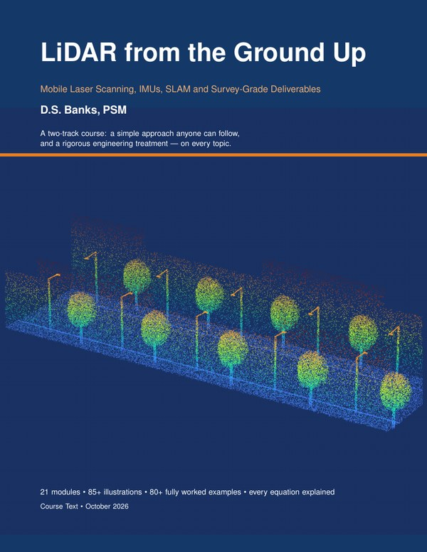

# LiDAR from the Ground Up
**Mobile Laser Scanning, IMUs, SLAM and Survey-Grade Deliverables** · D.S. Banks, PSM

*Look for this cover to be sure you have the official course materials.*

Source files for a continuing-education (CE) course for surveyors, engineers and geospatial professionals. The course covers mobile LiDAR from first principles ("light bounces back") through the factor-graph mathematics inside modern SLAM software such as LIO-SAM, and on to the accuracy statistics a surveyor signs off on.

It is a two-track course. Every module has a plain-language explanation anyone can follow, alongside a rigorous engineering treatment of the same topic.

The course was built from an earlier *Mobile LiDAR Basics* seminar, a four-module course outline, and the LIO-SAM research paper (Shan *et al.*, 2020). Those sources were reorganized, corrected and greatly expanded.

## Read the course

| Document | Description |
|----------|-------------|
| 📘 [**Course text** (PDF, 185 pages)](docs/LiDAR_from_the_Ground_Up_R0.pdf) | The full book: 21 modules, worked examples, labs, sample SOP, glossary and references |
| 🎤 [**Seminar slides with speaker notes** (PDF, 76 pages)](docs/Seminar_Slides_with_Notes_R0.pdf) | The six-hour seminar presentation, with the presenter's notes for each slide |

Both are revision R0 (October 2026), compressed for download.

## Download the exercise files

| File | Description | |
|------|-------------|---|
| 📊 [**Worked-examples workbook**](docs/LiDAR_Worked_Examples.xlsx) (Excel, 23 sheets) | Every worked example from the book, rebuilt with live formulas, one sheet per module, plus a Monte Carlo sheet and the capstone dataset | [⬇ Download](https://github.com/band72/Seminar-Mobile-LiDAR-from-the-Ground-Up/raw/main/docs/LiDAR_Worked_Examples.xlsx) |
| 📍 [**Sample checkpoints**](figs/sample_checkpoints.csv) (CSV, 30 points) | Checkpoint survey vs. LiDAR elevations with dE, dN and dZ, for the capstone accuracy test | [⬇ Download](https://github.com/band72/Seminar-Mobile-LiDAR-from-the-Ground-Up/raw/main/figs/sample_checkpoints.csv) |
| 🚗 [**Sample trajectory**](figs/sample_trajectory.csv) (CSV, 2 km) | Vehicle trajectory with position, heading, standard deviations and GNSS status, including a GNSS outage | [⬇ Download](https://github.com/band72/Seminar-Mobile-LiDAR-from-the-Ground-Up/raw/main/figs/sample_trajectory.csv) |

## Modules

| # | Module | Source |
|---|--------|--------|
| 1 | [What Is LiDAR?](ch01_intro.tex) | [`ch01_intro.tex`](ch01_intro.tex) |
| 2 | [The Math Toolkit](ch02_math.tex) | [`ch02_math.tex`](ch02_math.tex) |
| 3 | [Measuring Distance with Light](ch03_tof.tex) | [`ch03_tof.tex`](ch03_tof.tex) |
| 4 | [The Laser Beam and the Echo](ch04_beam.tex) | [`ch04_beam.tex`](ch04_beam.tex) |
| 5 | [From Angles and Distance to X, Y, Z](ch05_polar.tex) | [`ch05_polar.tex`](ch05_polar.tex) |
| 6 | [Rotation, Pose and Frames](ch06_rotation.tex) | [`ch06_rotation.tex`](ch06_rotation.tex) |
| 7 | [The IMU: Feeling Motion](ch07_imu.tex) | [`ch07_imu.tex`](ch07_imu.tex) |
| 8 | [Timing, GNSS and Motion Compensation](ch08_timing.tex) | [`ch08_timing.tex`](ch08_timing.tex) |
| 9 | [Lever Arm and Boresight Calibration](ch09_calib.tex) | [`ch09_calib.tex`](ch09_calib.tex) |
| 10 | [SLAM: Mapping While Finding Yourself](ch10_slam.tex) | [`ch10_slam.tex`](ch10_slam.tex) |
| 11 | [Scan Matching: Fitting Clouds Together](ch11_scanmatch.tex) | [`ch11_scanmatch.tex`](ch11_scanmatch.tex) |
| 12 | [Factor Graphs and LIO-SAM](ch12_factor.tex) | [`ch12_factor.tex`](ch12_factor.tex) |
| 13 | [Control, Error Budgets and Accuracy Standards (incl. ASPRS Edition 2)](ch13_accuracy.tex) | [`ch13_accuracy.tex`](ch13_accuracy.tex) |
| 14 | [Error Propagation and Error Budgets](ch13b_errprop.tex) | [`ch13b_errprop.tex`](ch13b_errprop.tex) |
| 15 | [Ouster OS0 Case Study: Errors and Resolution](ch13c_os0.tex) | [`ch13c_os0.tex`](ch13c_os0.tex) |
| 16 | [Choosing an IMU: AHRS, GNSS/INS and Tactical GNSS/INS](ch13d_gx5.tex) | [`ch13d_gx5.tex`](ch13d_gx5.tex) |
| 17 | [Survey-Grade Case Study: RIEGL VUX-240](ch13e_riegl.tex) | [`ch13e_riegl.tex`](ch13e_riegl.tex) |
| 18 | [Processing, QA/QC and Deliverables](ch14_processing.tex) | [`ch14_processing.tex`](ch14_processing.tex) |
| 19 | [Florida Standards of Practice, FDOT and the New Datums](ch14b_florida.tex) | [`ch14b_florida.tex`](ch14b_florida.tex) |
| 20 | [Professional Practice for LiDAR Surveys](ch14c_practice.tex) | [`ch14c_practice.tex`](ch14c_practice.tex) |
| 21 | [Capstone and Sample Project Dataset](ch15_capstone.tex) | [`ch15_capstone.tex`](ch15_capstone.tex) |

Back matter ([`ch16_back.tex`](ch16_back.tex)) includes answers to the in-text exercises, [hands-on labs](ch16b_labs.tex), a [sample SOP and client accuracy agreement](ch16c_sop.tex), an equation summary, a glossary and references. The front matter and "How to Use This Course" are in [`ch00_front.tex`](ch00_front.tex).

## Repository layout

| Path | Contents |
|------|----------|
| [`docs/`](docs/) | Course text and seminar slides (PDF) and the worked-examples workbook (see [Read the course](#read-the-course) and [Download the exercise files](#download-the-exercise-files)) |
| [`main.tex`](main.tex) | Master document. Build this to produce the course text. |
| `ch*.tex` | Module chapters (linked in the table above) |
| [`ins_asprs.tex`](ins_asprs.tex), [`ins_pen.tex`](ins_pen.tex), [`ins_rhr.tex`](ins_rhr.tex), [`ins_traj.tex`](ins_traj.tex) | Inserts used within the chapters |
| [`quiz_items.tex`](quiz_items.tex), [`sample_table.tex`](sample_table.tex) | Quiz questions (no answers) and the sample results table |
| [`figs/`](figs/) | Figures |
| [`figs/sample_trajectory.csv`](figs/sample_trajectory.csv), [`figs/sample_checkpoints.csv`](figs/sample_checkpoints.csv), [`figs/sample_stats.json`](figs/sample_stats.json) | Sample project dataset used in the capstone |
| [`style.py`](style.py), `figs1.py` … `figs9.py`, [`crop.py`](crop.py) | Scripts that generate the figures |
| [`calc.py`](calc.py), [`calc2.py`](calc2.py), [`calc3.py`](calc3.py), [`calc_ep.py`](calc_ep.py), [`calc_ep2.py`](calc_ep2.py), [`calc_riegl.py`](calc_riegl.py), [`calc_trav.py`](calc_trav.py) | Scripts behind the worked examples' numbers |
| [`usfix.py`](usfix.py) | Converts British spellings to US spellings in the chapter files |
| [`xl/`](xl/) | Builds the companion Excel workbook of worked examples ([`xl/build.py`](xl/build.py)) |
| [`review/`](review/) | [`tech_review.py`](review/tech_review.py) recomputes key printed values; results in [`Technical_Review_Log.txt`](review/Technical_Review_Log.txt) |
| [`LICENSE`](LICENSE), [`LICENSE-CODE`](LICENSE-CODE) | Content license (CC BY-NC-ND 4.0) and code license (MIT) |

## Building

**Course text (PDF)**: requires a LaTeX distribution such as TeX Live, with TikZ.

```bash
latexmk -pdf main.tex
```

**Figures**: requires Python 3 with `matplotlib`, `numpy` and `Pillow`.

```bash
python3 figs1.py
```

(Repeat for `figs2.py` … `figs9.py`.)

**Worked-examples workbook**: a ready-made copy is in [`docs/`](docs/LiDAR_Worked_Examples.xlsx). To rebuild it, install `openpyxl`; the script writes `xl/LiDAR_Worked_Examples.xlsx`.

```bash
cd xl && python3 build.py
```

**Technical review**: recomputes key printed values and reports PASS/CHECK.

```bash
python3 review/tech_review.py
```

## Assessment materials

The quiz answer key and the final-exam builder are not published here. Instructors can request them from the author.

## Updates

This course is maintained as a living document and will be refined at regular intervals as standards and technology change. A project-based companion with worked, real-world examples is in development to clarify and standardize LiDAR deliverables.

Each revision is published as a [GitHub Release](https://github.com/band72/Seminar-Mobile-LiDAR-from-the-Ground-Up/releases) with a summary of what changed. Questions, corrections and project ideas for the companion are welcome in [Discussions](https://github.com/band72/Seminar-Mobile-LiDAR-from-the-Ground-Up/discussions).

## Tools

### LiDAR Contour Studio — open-source contour generator for LAS/LAZ
**Repository:** [github.com/band72/Lidar_Prj_2026](https://github.com/band72/Lidar_Prj_2026)

An open-source companion tool, released under the MIT License, for turning LAS/LAZ point clouds into contours and surfaces:

- Filters ground points by ASPRS class and removes statistical outliers
- Crops by a latitude/longitude bounding box drawn on a map, and by elevation
- Exports contours to GeoJSON, Shapefile, AutoCAD DXF and GeoPackage, and a DEM to GeoTIFF
- Writes QA/QC reports (HTML, Markdown, JSON) covering metadata, point density, datums and limitations
- Runs on Windows, Linux and Android, with a touch-friendly web interface

It applies the processing and QA/QC steps taught in Module 18 of the seminar.

### Scout Maps the Park: SLAM animation

[](https://band72.github.io/Seminar-Mobile-LiDAR-from-the-Ground-Up/slam-animation.html)

An interactive, eight-step animation of how SLAM works: look, roll and guess, match, fix, and close the loop. Each step includes a note in survey terms.

▶ **[Open the interactive animation](https://band72.github.io/Seminar-Mobile-LiDAR-from-the-Ground-Up/slam-animation.html)**

▶ **[SLAM Lectures for Beginning Learning](https://www.youtube.com/watch?v=B2qzYCeT9oQ&list=PLpUPoM7Rgzi_7YWn14Va2FODh7LzADBSm)** · [Interactive SLAM animation](https://band72.github.io/Seminar-Mobile-LiDAR-from-the-Ground-Up/slam-animation.html)

## To-do

- [ ] Independent review of the Florida standards module by a second PSM
- [ ] Expand the examples for post processing the bulk data with open source software and integrate with Civil 3D.
- [ ] Add the FDOT Mobile LiDAR (TML) accuracy tolerances for Types A, B and C from the current Surveying and Mapping Handbook
- [ ] Update the book's agenda to match the slide deck (SLAM as the 70-minute core block)
- [ ] Replace the simulated capstone dataset with a real, de-identified project
- [ ] Release the project-based companion with real-world LiDAR deliverable examples
- [ ] Re-check the NSRS modernization timeline before each offering
- [ ] Conceptualize each breakout topic with 5 minute summary
- [x] SLAM animation (Scout Maps the Park)
- [x] Worked-example Excel workbook

## Disclaimer

This material is for education only. It is not legal or professional advice and does not replace the judgment of a licensed surveyor and mapper. Standards, rules and specifications change. Always verify the current editions of the ASPRS standards, Chapter 5J-17 F.A.C., FDOT requirements and NSRS guidance before relying on them for a project.

## License

**Course content** (book, slides, LaTeX sources, figures, workbook and sample data): [CC BY-NC-ND 4.0](https://creativecommons.org/licenses/by-nc-nd/4.0/). You may share it with credit, for non-commercial purposes, without modification. For commercial use, adaptation or instructor licensing, contact the author.

**Code** (the Python scripts): MIT. See [LICENSE-CODE](LICENSE-CODE).

Full terms are in [LICENSE](LICENSE).
